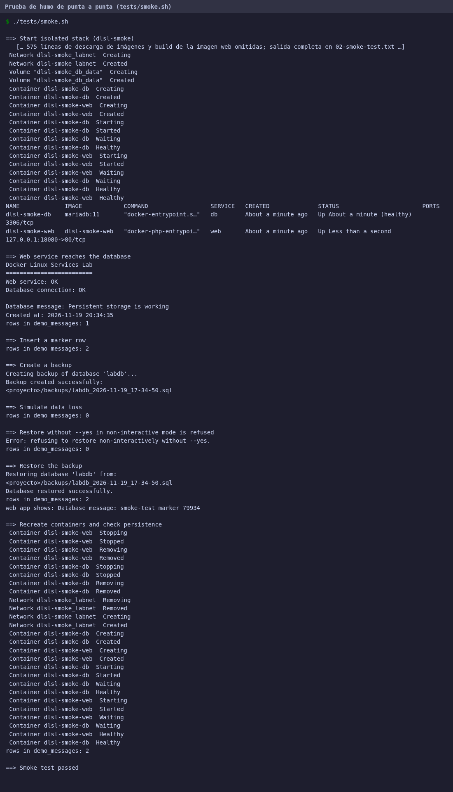

[🇪🇸 Español](README.md) | 🇬🇧 English

# Docker Linux Services Lab

[](https://github.com/lucasezekiel/docker-linux-services-lab/actions/workflows/ci.yml)

A hands-on Linux systems administration lab built with Docker Compose.

The project deploys a PHP/Apache web service connected to a MariaDB database and demonstrates container networking, persistent storage, service health checks, database initialization, backup and recovery, continuous integration, and troubleshooting.

## Architecture

```text
GNU/Linux Host
      |
      v
Docker Compose
      |
      +-------------------------+
      |                         |
      v                         v
 Web Service                Database
 Apache + PHP               MariaDB
      |                         |
      +------ labnet -----------+
                                |
                                v
                     Persistent Docker Volume
```

The web service communicates with MariaDB through an internal Docker network.

Only the web service is published to the host on port `8080`.

MariaDB has no published host port.

## Technologies

- GNU/Linux
- Docker Engine
- Docker Compose
- Apache HTTP Server
- PHP
- MariaDB
- SQL
- Bash
- Git
- GitHub Actions
- ShellCheck

## Features

- Multi-container deployment with Docker Compose
- Custom PHP/Apache Docker image
- Internal Docker network
- Persistent MariaDB storage
- Automatic SQL database initialization
- MariaDB health monitoring
- Service dependency based on database health
- Environment-based configuration
- Bash backup automation
- Bash restore automation
- Shell scripts validated with ShellCheck
- Continuous integration with GitHub Actions
- Automated ShellCheck, Compose validation, and Docker image build
- Tested container recreation and data persistence
- Tested database backup and recovery

## Project Structure

```text
.
├── .github/
│   └── workflows/
│       └── ci.yml
├── app/
│   ├── Dockerfile
│   └── index.php
├── backups/
│   └── .gitkeep
├── db/
│   └── init.sql
├── scripts/
│   ├── backup-db.sh
│   └── restore-db.sh
├── tests/
│   ├── compose.smoke.yaml
│   └── smoke.sh
├── evidencias/
├── .env.example
├── .gitignore
├── compose.yaml
├── LICENSE
└── README.md
```

Backup files and the local `.env` file are intentionally excluded from version control.

## Requirements

Docker Engine and Docker Compose are required.

Verify the installation:

```bash
docker --version
docker compose version
docker info
```

## Configuration

Create a local environment file:

```bash
cp .env.example .env
```

Edit `.env` and define the database credentials.

The local `.env` file is ignored by Git and should not be committed.

## Start the Lab

Validate the Compose configuration:

```bash
docker compose config -q
```

Build and start the services:

```bash
docker compose up -d --build
```

Check their status:

```bash
docker compose ps
```

The MariaDB service should eventually report:

```text
healthy
```

## Test the Application

Query the web service:

```bash
curl http://localhost:8080
```

Example output:

```text
Docker Linux Services Lab
=========================
Web service: OK
Database connection: OK

Database message: Persistent storage is working
```

This confirms that:

- the web container is running;
- PHP is working;
- Docker DNS resolves the `db` service;
- the web container can connect to MariaDB;
- the initialization data is available.

## Persistent Storage Test

A second record was inserted manually into MariaDB.

The containers were then removed:

```bash
docker compose down
```

The services were recreated:

```bash
docker compose up -d
```

The record remained available.

This demonstrates that the database lifecycle is independent from the container lifecycle because MariaDB stores its data in a named Docker volume.

The volume can be inspected with:

```bash
docker volume ls
```

Important:

```bash
docker compose down
```

removes the containers but preserves the volume.

However:

```bash
docker compose down -v
```

also removes the persistent volume and therefore destroys the database data.

## Database Backup

Create a SQL backup with:

```bash
./scripts/backup-db.sh
```

The script:

1. loads the local database configuration;
2. executes `mariadb-dump` inside the database container, reading the root password from the container's environment so it never appears on a command line or in `ps` output;
3. writes the dump to a hidden temporary file and publishes it only if it is not empty;
4. stores it under `backups/` with owner-only permissions (`umask 077`).

Example:

```text
backups/labdb_2026-09-14_03-13-58.sql
```

SQL backup files are excluded from Git.

## Database Restore

Restore a backup with:

```bash
./scripts/restore-db.sh backups/<backup-file>.sql
```

The script asks you to type the database name before overwriting anything. For automation, pass `--yes`; without it, a non-interactive run is refused.

The recovery procedure was tested by deliberately deleting all records from the demonstration table.

```text
Working database
       |
       v
SQL backup created
       |
       v
Records deleted
       |
       v
Data loss verified
       |
       v
SQL backup restored
       |
       v
Data recovered
```

The recovery was verified both with direct SQL queries and through the PHP application.

## Shell Script Validation

The backup and restore scripts were checked using ShellCheck:

```bash
shellcheck scripts/backup-db.sh scripts/restore-db.sh tests/smoke.sh
```

This helps detect common Bash scripting errors and portability issues.

## Continuous Integration

GitHub Actions runs automatically on pushes and pull requests to `main`.

The CI workflow performs:

- ShellCheck validation of the Bash scripts
- Docker Compose configuration validation
- Docker image build verification
- An end-to-end smoke test (`tests/smoke.sh`) that runs the full backup and recovery cycle

The workflow is defined in:

```text
.github/workflows/ci.yml
```

This provides an automated check that the repository remains valid after changes.

## End-to-end Smoke Test

`tests/smoke.sh` starts an isolated copy of the stack (Compose project `dlsl-smoke`, its own containers and volume, port `127.0.0.1:18080`) and checks:

1. the web service reaches the database;
2. a marker row is inserted and included in a new backup;
3. all rows are deleted (simulated data loss);
4. a restore without `--yes` in non-interactive mode is refused;
5. the restore brings the marker back, and the web app serves it;
6. after `docker compose down` and `up`, the data is still there.

```bash
./tests/smoke.sh
```

The isolated copy and its volume are removed at the end, so a regular lab started with `docker compose up` is not touched. Set `KEEP_SMOKE=1` to keep it for inspection.

## Evidence

Real run on 2026-11-19 on Debian 13 with Docker 26.1.5 and Compose 2.26.1:

| Test | Result |
|---|---|
| ShellCheck + `compose config` | no warnings |
| `tests/smoke.sh` | backup → loss → restore → persistence: **passes** |
| Service state | MariaDB `healthy`; only the web service publishes a port |
| Manual backup | `0600` file |
| Restore | aborts on a wrong answer; restores after typing the database name |



📸 All screenshots and output in [`evidencias/`](evidencias/README.md) (Spanish).

## Health Check and Troubleshooting

During the initial deployment, MariaDB was temporarily reported as unhealthy.

The problem was investigated with:

```bash
docker compose ps
docker compose logs db
docker inspect sysadmin-lab-db
```

The logs showed that MariaDB was still performing its first-time database initialization.

The initialization process took longer than the original health-check retry window.

A startup grace period was therefore added:

```yaml
start_period: 90s
```

This allows MariaDB enough time to initialize before failed health checks are counted.

This troubleshooting exercise demonstrated an important distinction:

```text
Container running != Application ready
```

A container may be running while the service inside it is still initializing.

## Useful Commands

Check service status:

```bash
docker compose ps
```

View all logs:

```bash
docker compose logs
```

View database logs:

```bash
docker compose logs db
```

View web logs:

```bash
docker compose logs web
```

Restart the services:

```bash
docker compose restart
```

Stop the lab while preserving data:

```bash
docker compose down
```

## Security Considerations

This lab follows several basic security practices:

- credentials are stored in a local `.env` file;
- `.env` is excluded from Git;
- database backups are excluded from Git;
- MariaDB has no published host port;
- the web application uses a dedicated database user;
- application services communicate through a dedicated Docker network.

For a production environment, additional measures would be required, including secret management, TLS, restricted privileges, backup encryption, access control, monitoring, and regular updates.

## Learning Objectives

This project was created to demonstrate practical skills related to:

- Linux systems administration
- Docker container management
- Docker Compose
- service networking
- persistent storage
- health checks
- SQL database administration
- backup and recovery
- Bash automation
- continuous integration
- log analysis
- troubleshooting
- Git version control

## License

This project is licensed under the MIT License.

See the `LICENSE` file for details.

## Project Status

Completed and tested in a GNU/Linux lab environment.

The project is intended as a practical systems administration exercise rather than a production deployment.
